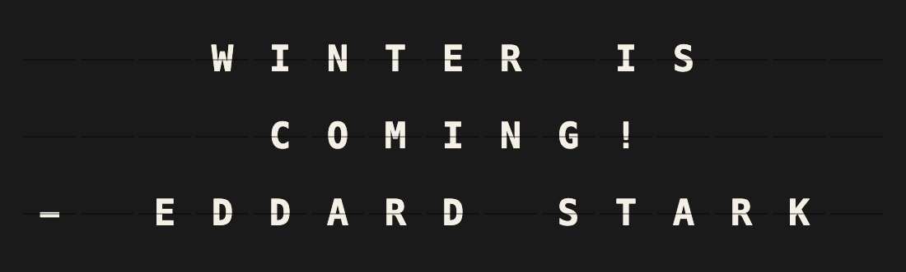

# Game of Thrones Quotes Plugin

A Game of Thrones quote on the board, a new one on every refresh: word-wrapped, centered, and signed with the character who said it — only quotes that fit the board it is shown on.



## Overview

196 quotes from 48 characters of the TV show ship with the plugin in [`data.json`](data.json): nothing is downloaded, no account or API key. Each character comes with their house and the shorter names they go by, which the **Characters** and **Houses** pickers and the signature are built from.

Only quotes that fit the board are picked, all of them equally likely:

- A **Note** (15×3) gets the short ones, 54 of the 196. Most leave no row for the name, so it is left off rather than the quote cut.
- A **Flagship** (22×6) gets the long ones too, 169 of them, nearly all signed.

Quotes shown in the last 50 refreshes are passed over; once every quote that fits has been shown, the one shown longest ago comes next.

### On a Note (15×3)

```
   WINTER IS
    COMING!
- EDDARD STARK
```

### On a Flagship (22×6)

```
   A LION DOES NOT
 CONCERN HIMSELF WITH
THE OPINION OF SHEEP.

  - TYWIN LANNISTER
```

The layout is computed from the board's size, so any other shape — a note array, a FiestaPanel grid — gets the quotes that fit its own width and height. A name too long for its row is shortened to the name the character goes by: `- TYRION LANNISTER` becomes `- TYRION` and `- SANDOR CLEGANE` becomes `- THE HOUND` on a Note.

## Template Variables

### Quote

| Variable | Description | Example |
|----------|-------------|---------|
| `{{game_of_thrones_quotes.quote}}` | The quote as board text, not wrapped | `WINTER IS COMING!` |
| `{{game_of_thrones_quotes.character}}` | The full name of the character | `EDDARD STARK` |
| `{{game_of_thrones_quotes.house}}` | The character's house, empty for those without one | `HOUSE STARK OF WINTERFELL` |

### Board Lines

| Variable | Description |
|----------|-------------|
| `{{game_of_thrones_quotes.block}}` | The whole layout, rows separated by newlines — put it on the first template line |
| `{{game_of_thrones_quotes.line1}}` … `{{game_of_thrones_quotes.line6}}` | The same rows one by one, full board width; empty past the board's height |

## Example Templates

### The built-in layout

Put this on the first line of a page, with the line set to left alignment and no wrap — the plugin pads and centers the rows itself:

```
{{game_of_thrones_quotes.block}}
```

### Your own layout

The quote and character variables are not wrapped or shortened to the board — `{{game_of_thrones_quotes.block}}` is what is laid out for it. For a layout of your own, let the template engine wrap the quote:

```
{{game_of_thrones_quotes.quote|wrap}}
- {{game_of_thrones_quotes.character}}
```

The quote was still chosen to fit the board on its own, so it leaves room for the name line only on a Flagship.

## Configuration

| Setting | Default | |
|---------|---------|---|
| Characters | any | Only quotes by these characters. |
| Houses | any | Only quotes by members of these houses. |
| Show character | on | Sign the quote. Shortened to the name the character goes by, or left off when there is no row for it. |
| Skip crude language | off | Leave out the quotes with swearing in them, most of them the Hound's. |
| Alignment | Centered | Centered, with the name centered below; or left-aligned, with the name flush right. |
| Refresh interval | 3600 s | How long a quote stays up. Minimum 60 s: everything happens locally. |

With characters and houses both chosen, each quote is by one of the chosen characters or from one of the chosen houses — *House Stark* and *Hodor* gives every Stark and Hodor. A selection with nothing short enough for the board shows the shortest of its quotes, cut off with `...`.

No API key, no account, no environment variables.

## Features

- 196 quotes from 48 characters, shipped with the plugin — works offline
- Only quotes that fit: short ones on a Note, long ones too on a Flagship
- Signed with the name the character goes by when the full one does not fit: `- TYRION`, `- THE HOUND`, `- THE MAD KING`
- Pickers for characters and houses, each with how many quotes it brings
- No repeats of the last 50 quotes where it can be avoided
- Board-adaptive, verified by FiestaBoard's geometry conformance suite on every supported board shape

## Author

Oliver Rummeyer

## Development

The plugin imports `src.plugins.base` from the FiestaBoard core, so tests need the core repo checked out next to this one:

```bash
git clone https://github.com/Fiestaboard/FiestaBoard.git ../FiestaBoard

# Import paths matching how FiestaBoard loads the plugin
mkdir -p plugins && touch plugins/__init__.py
ln -sfn .. plugins/game_of_thrones_quotes

python -m venv .venv && .venv/bin/pip install pytest pytest-cov requests
PYTHONPATH=".:../FiestaBoard" .venv/bin/pytest tests/ --cov=. --cov-report=term-missing
```

The plugin tests run on a small fixture collection, so a change to the quotes never breaks a test of the layout. The board previews in `manifest.json` are rendered from that fixture, and a test fails if they drift from what the code produces.

### The quotes

[`data.json`](data.json) holds three lists:

```json
{
  "houses":     { "stark": { "name": "House Stark of Winterfell" } },
  "characters": { "ned":   { "name": "Eddard Stark", "short_names": ["Ned Stark", "Ned"], "house": "stark" } },
  "quotes":     [ { "character": "ned", "text": "Winter is coming!" } ]
}
```

`short_names` are the names a character goes by, longest first; the signature takes the longest of the full name and these that fits the row. `house` is `null` for characters without one. Tests check the file: every quote readable on the board as written, no quote twice, every character and house quoted, and every name fitting a Note in one of its forms.

## License

MIT, for the code. The quotes are from the TV series *Game of Thrones* (HBO), after the novels by George R. R. Martin.
