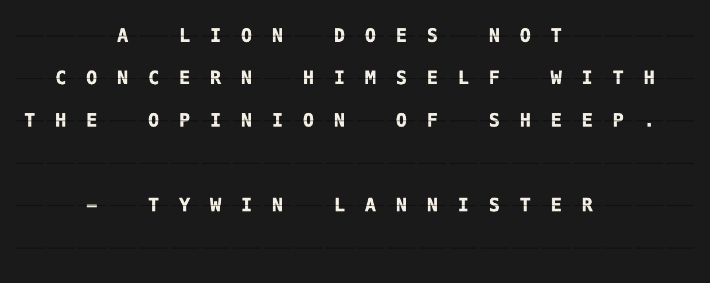

# Game of Thrones Quotes Setup Guide

Show a quote from Game of Thrones on your Vestaboard, signed with the character who said it.

## Overview

**What it does:**

- A new quote on every refresh, word-wrapped and centered
- Only quotes that fit your board: the short ones on a Note, the long ones too on a Flagship
- Signed with the character's name, or the name they go by when the full one does not fit (`- TYRION`, `- THE HOUND`)
- Optionally only quotes by the characters or houses you choose

**Prerequisites:** None — works out of the box. The 196 quotes ship with the plugin, so there is no account, no API key and nothing to download.

## Quick Setup

### 1. Enable the Plugin

Open **Integrations** in FiestaBoard, find **Game of Thrones Quotes** and install it. Then open its card and switch **Enabled** on.

### 2. Configure Game of Thrones Quotes

Nothing is required. To narrow the quotes down, pick **Characters** or **Houses** — each option shows how many quotes it brings. Switch on **Skip crude language** if the board hangs where children read it.

### 3. Create a Board Template

Create a page and put this on its **first** line, with the line set to left alignment and no wrap:

```
{{game_of_thrones_quotes.block}}
```

That one variable fills the board. FiestaBoard splits it across the board rows, and the rows are exactly as wide as the board, so nothing gets cut or shifted.

### 4. View on Your Board

The board shows a quote like this on a Note:


And like this on a Flagship:



## Template Variables

| Variable | Description | Example |
|----------|-------------|---------|
| `{{game_of_thrones_quotes.block}}` | The whole layout, rows separated by newlines | see above |
| `{{game_of_thrones_quotes.line1}}` … `{{game_of_thrones_quotes.line6}}` | The same rows one by one; empty past the board's height | |
| `{{game_of_thrones_quotes.quote}}` | The quote as board text, not wrapped | `WINTER IS COMING!` |
| `{{game_of_thrones_quotes.character}}` | The character's full name | `EDDARD STARK` |
| `{{game_of_thrones_quotes.house}}` | The character's house, empty for those without one | `HOUSE STARK OF WINTERFELL` |

## Configuration Reference

| Setting | Default | Description |
|---------|---------|-------------|
| Characters | any | Only quotes by these characters. |
| Houses | any | Only quotes by members of these houses. Combined with characters, each quote is by one of the chosen characters or from one of the chosen houses. |
| Character name | When it fits | Sign the quote with the character's name: **When it fits**, **Always** (only quotes with room for it — on a Note 21 instead of 54) or **Never**. |
| Skip crude language | off | Leave out the quotes with swearing in them. |
| Alignment | Centered | Centered, with the name centered below; or left-aligned, with the name flush right. |
| Refresh interval | 3600 s | How long a quote stays up. Minimum 60 s. |

### Environment Variables

None.

## Troubleshooting

**A Note shows the same few quotes.** A Note fits 54 of the 196 quotes, fewer when you pick characters or houses. The plugin does not repeat any of the last 50 while another one fits, so a narrow selection comes round again sooner.

**The quote is cut off with `...`.** None of the chosen characters' or houses' quotes fits this board. Pick more characters, or none.

**The board shows "No quotes by the chosen characters or houses".** The selection no longer matches any quote, for example after a character was renamed in an update. Open the settings and pick again.

**There is no name under the quote.** On a Note most quotes take all three rows. The name is left off rather than the quote cut. Set **Character name** to *Always* to show signed quotes only.
